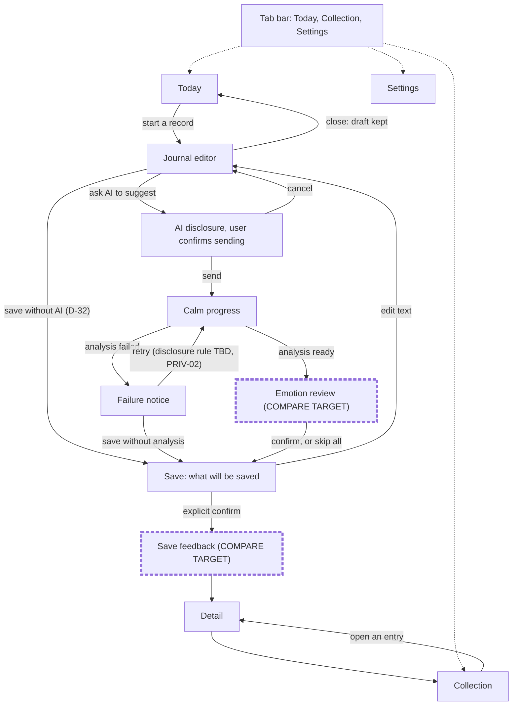

# 03a — Low-fidelity wireframes and core flow (LUN-14, UX-01)

Companion to `docs/03_UX_AND_USER_FLOWS.md` (behavior) and `docs/04_VISUAL_DESIGN_SPEC.md` (look). If this file and docs/03 ever disagree, fix both in the same change. These are **low-fi structure sketches for the owner's review**, not a visual design: no colors, fonts, sizes or final copy. The high-fi core flow is a separate deliverable (docs/04).

## How to read
- Shapes are lines only (`+ - |`), because the UI has no background fills (D-36). Nothing in a sketch implies a filled area.
- Labels are English placeholders. Korean copy examples live in docs/03 ("Copy examples"); final copy is TBD.
- `[ Text ]` is a tappable outlined control. `(...)` is a note on the sketch, not UI.
- **COMPARE TARGET**: an interaction key point where two variants should be built and compared on a device (mode B candidates, `docs/11_AGENT_WORKFLOW.md`). This file only names what would differ. It does not design the variants.
- **TBD (D-xx)**: undecided; nothing is invented here.
- **PROVISIONAL**: part of the receipt/collection metaphor (D-12, D-35, D-37). It lives only in `src/receipt` and `app/receipt`, and is the one place where prices, a balance and a streak may appear (prototype, synthetic data). Core screens use neutral names ("Collection", "Detail").

## Rules every screen follows
1. No streak, score, ranking, percentage-of-mood or guilt copy on any core screen. The only exception is the PROVISIONAL receipt, kept isolated (D-37).
2. Writing can start before any emotion is chosen. Choosing or accepting emotions is never a prerequisite for typing or saving.
3. The user is the final interpreter. AI only proposes, and nothing it proposes is confirmed by default.
4. The original text is shown as the user wrote it and is never rewritten (D-31). AI-derived content is always labeled as such.
5. Several, even conflicting, emotions may sit side by side. They are not ranked or merged.
6. The AI step is optional (D-32): every path that reaches Save can skip it.
7. Reduced motion, screen readers and large text are supported; meaning is never carried by color or animation alone.

## Core flow
Matches docs/03 "Primary flow" (the clarification step is Deferred, D-15, so it is not drawn).



Notes:
- Leaving at any step keeps the draft (docs/03 "Journal editor"); nothing asks the user to finish.
- The first send goes through the disclosure; text is never sent before the user agrees. Whether a retry asks again or reuses that consent is TBD until PRIV-02 (per request or once), so the retry edge above is not decided.
- Whether editing text after an analysis keeps or invalidates the candidates follows D-31 (the user must re-confirm after a text change). The screen behavior for that is TBD (PRIV-01/COL-01).

## Tab bar (shared by Today, Collection, Settings)
Three tabs, as in the current app shell. No stats, social or AI-chat tab (docs/03). The selected tab is shown by a short line under its label (D-34), not by a filled shape.

```
+------------------------------------------+
|   Today        Collection     Settings   |
|   -----                                  |
+------------------------------------------+
```
The tab bar is hidden on the Journal editor so writing has the whole screen (a full-screen push from Today).

## 1. Today
Purpose: a quiet entry point. Never required, never counting.

```
+------------------------------------------+
|  Today                                   |
|                                          |
|                                          |
|   (one gentle prompt, no day counter)    |
|                                          |
|   +----------------------------------+   |
|   |   [ Write something ]            |   |
|   +----------------------------------+   |
|                                          |
|   Continue your draft  >                 |
|   (only if a draft exists: first         |
|    line of the draft, nothing else)      |
|                                          |
|   Earlier today  >                       |
|   (only if records exist: plain list,    |
|    no totals, no counts)                 |
|                                          |
+------------------------------------------+
|   Today        Collection     Settings   |
+------------------------------------------+
```
- No streak, score, "days in a row", daily goal or "you haven't written" copy. Empty and busy days look the same.
- Multiple entries per day: shown as separate items, one per entry. Whether "a day" is a unit anywhere is TBD (D-14).
- The receipt is not linked from Today. It is reached from a saved record's Detail only (PROVISIONAL).

## 2. Journal editor
Purpose: free writing first. Emotions are never asked for here.

```
+------------------------------------------+
|  [ Close ]                   [ Save ]    |
|                                          |
|  (large writing area, long-form,         |
|   placeholder: an open invitation to     |
|   write, no emotion picker anywhere)     |
|                                          |
|  |                                       |
|                                          |
|                                          |
|                                          |
|------------------------------------------|
|  [ Suggest feelings with AI ]  (optional)|
|  (one line: text is sent only after you  |
|   agree on the next screen)              |
+------------------------------------------+
```
- `[ Save ]` and `[ Suggest feelings with AI ]` are disabled while the text is empty or only whitespace. Both are enabled with no emotion chosen.
- `[ Save ]` goes to Save (plain save, D-32). `[ Suggest feelings with AI ]` goes to the disclosure (below).
- Close keeps the draft. A transient error never loses typed text.
- No character counter targets, no "write more" nudges. (An optional gentle prompt for short entries is a receipt-side idea in D-37 and is not part of the core editor; TBD whether it exists at all.)

### AI disclosure (before sending)
```
+------------------------------------------+
|  Before we send your text                |
|                                          |
|  (what is sent, to whom, what is kept,   |
|   that AI only suggests and you decide)  |
|                                          |
|  [ Send and suggest ]     [ Not now ]    |
+------------------------------------------+
```
Exact disclosure text, and whether it is per request or once, depend on PRIV-02 and D-08/D-17 (TBD).

### Calm progress (after sending)
```
+------------------------------------------+
|                                          |
|        (a quiet, slow line motion)       |
|                                          |
|   Reading what you wrote...              |
|   You can leave. We'll keep your draft.  |
|                                          |
|   [ Cancel ]                             |
+------------------------------------------+
```
No timer countdown, no percentage. Motion is replaced by a static line under reduced motion. Failure shows a notice with `[ Try again ]` and `[ Save without AI ]`; the draft is untouched.

## 3. Emotion review (COMPARE TARGET)
Purpose: the user reads what AI proposes and decides. This is the most sensitive interaction, so it should be compared on a device before the high-fi design is fixed.

Baseline sketch (one possible arrangement, not a chosen design):

```
+------------------------------------------+
|  [ Back ]        What we noticed         |
|  (these are suggestions; you decide)     |
|                                          |
|  +------------------------------------+  |
|  | Relieved                           |  |
|  | "the call finally ended"           |  |
|  | (a quote of your own words)        |  |
|  | [ Keep ] [ Edit ] [ Remove ]       |  |
|  +------------------------------------+  |
|                                          |
|  +------------------------------------+  |
|  | Anxious                            |  |
|  | "I kept checking my phone"         |  |
|  | Not sure about this one            |  |
|  | [ Keep ] [ Edit ] [ Remove ]       |  |
|  +------------------------------------+  |
|                                          |
|  (feelings can coexist, even opposite    |
|   ones; none is ranked above another)    |
|                                          |
|  [ Add a feeling ]   [ Skip all ]        |
|------------------------------------------|
|  [ Continue ]                            |
+------------------------------------------+
```
What the screen must show or allow (docs/03 "Emotion review"):
- Label, an optional plain-language description, and an evidence snippet that is the matched span of the user's own text, never the model's rewording (D-33).
- Uncertainty shown as plain words, separately from the label. No confidence percentage by default.
- Keep (accept), Edit, Remove, Add (including a label the user writes), and Skip all. Rejecting or skipping every candidate is valid, and `[ Continue ]` stays enabled.
- Zero candidates shows a calm "nothing stood out" state with `[ Add a feeling ]` and `[ Continue ]`; it never reads as a failure.
- Nothing is pre-accepted. A candidate counts as the user's only after Keep or Edit.
- Optional intensity appears only if a scale is approved (TBD). The receipt's "size of a feeling" (D-37, scale TBD) is not drawn here; whether it is asked in this step or inside the PROVISIONAL receipt module is undecided.

Compare target, what would differ between two variants (not designed here):
- How candidates are presented: all at once as a list vs one at a time.
- How evidence and uncertainty are shown: inline under each label vs revealed on demand.
- How mixed feelings sit together: stacked, or grouped by the event they came from.
- How an edit is made: inline vs a separate small sheet; how fast "Skip all" is to reach.
Judged on: does it feel like the user is correcting a suggestion rather than answering an interview, and is rejecting everything easy and guilt-free.

## 4. Save (what will be saved)
Purpose: an explicit confirmation that separates the three layers (docs/03 "Save"; docs/06 stores them separately).

```
+------------------------------------------+
|  [ Back ]            Review and save     |
|                                          |
|  Your words                              |
|  | (original text, as written,           |
|  |  scrollable, never altered)           |
|                                          |
|  Written by AI (only if it was used)     |
|  | (summary, labeled as AI-made;         |
|  |  can be left out)                     |
|                                          |
|  Your feelings                           |
|  | Relieved     | Anxious                |
|  | (confirmed by you; may be none)       |
|                                          |
|------------------------------------------|
|  [ Save ]                                |
|  (nothing is saved until you tap this)   |
+------------------------------------------+
```
- Reached from Emotion review, from the editor (plain save, D-32) or from a failure notice (save without analysis). With no AI, the "Written by AI" block is absent and "Your feelings" is empty. TBD (owner decision): whether plain Save offers manual emotion entry. Option 1: no manual labels on plain Save (labels come only from the AI review). Option 2: a manual add step before Save (a new step, not drawn here). Until decided, no manual add path exists in these wireframes.
- AI success never reaches Save on its own, and Save is never a default action of a gesture or timeout.
- Double taps must not create two records (docs/03 edge cases). `[ Back ]` returns to the previous step with choices kept; an edit-text path returns to the editor.

## 5. Save feedback (COMPARE TARGET)
Purpose: the moment after `[ Save ]`. It must confirm without celebrating or scoring.

Baseline sketch (placeholder only):

```
+------------------------------------------+
|                                          |
|        Saved.                            |
|        (one calm line, a short           |
|         line-drawn motion)               |
|                                          |
|        [ Open it ]       [ Done ]        |
+------------------------------------------+
```
Fixed requirements (both variants): saved is stated only after the backend confirms; a failed save keeps everything and offers retry; a static equivalent under reduced motion; no points, no streak and no "good job" or loss wording.

Compare target, what would differ between two variants (not designed here):
- Where it appears: inline on the Save screen vs on arrival at Detail vs a transient notice over Collection.
- How long it lasts and how it moves (still, a single line draw, a ripple per D-36), and whether it dismisses itself.
- The next step offered: open the record, return to Today, or (PROVISIONAL) offer the receipt view.
Judged on: does it feel finished and quiet, and does it tempt the user to measure themselves.

## 6. Collection
Neutral name. A plain, date-ordered list, with no forced receipt-like layout (docs/03).

```
+------------------------------------------+
|  Collection                              |
|                                          |
|  Nov 18                                  |
|  +------------------------------------+  |
|  | Short preview of the first lines   |  |
|  | of the entry...                    |  |
|  | Relieved, Anxious                  |  |
|  +------------------------------------+  |
|                                          |
|  Nov 16                                  |
|  +------------------------------------+  |
|  | Short preview of the first lines   |  |
|  | of the entry...                    |  |
|  | (no feelings added)                |  |
|  +------------------------------------+  |
|                                          |
|  [ Show earlier ]                        |
+------------------------------------------+
|   Today        Collection     Settings   |
+------------------------------------------+
```
- Newest first, with a short preview from the original text. User-confirmed feelings appear as plain labels, or nothing when none were added. AI-only suggestions are never shown as the user's feelings.
- Pagination: how more entries load (button vs scrolling) is TBD. The sketch uses a button as a placeholder.
- Several entries on one date appear as separate items. Grouping by day is TBD (D-14).
- Empty state: one calm line and `[ Write something ]`. No "nothing yet, start your streak" wording.
- No totals, trends, charts, rankings or look-back here. A look-back belongs to the PROVISIONAL receipt (D-37) and is not part of this list.
- Search and filters are not in this wireframe (not in the MVP scope reviewed here).

## 7. Detail
```
+------------------------------------------+
|  [ Back ]              [ Edit ] [ Delete ]|
|  Nov 18, 21:40                           |
|                                          |
|  Your feelings                           |
|  | Relieved   "the call finally ended"   |
|  | Anxious    "I kept checking my phone" |
|  | (confirmed by you; empty is fine)     |
|                                          |
|  Your words                              |
|  | (original text, as written)           |
|                                          |
|  Written by AI (if any)                  |
|  | (summary, labeled as AI-made)         |
|                                          |
|  Receipt view  >   (PROVISIONAL)         |
+------------------------------------------+
```
- The confirmed interpretation is the primary block, the original text is one tap away or visibly below it, and AI-derived content is labeled (docs/03 "Collection/detail").
- `[ Edit ]` and `[ Delete ]` are visible, not hidden in a gesture. Editing never rewrites the original; edits are revisions, and after a text change the user re-confirms the interpretation (D-31). The revision display is TBD (PRIV-01/COL-01).
- `[ Delete ]` opens a confirm dialog and states that deletion is complete only after the backend confirms (D-30, docs/02). Retention after deletion (backups) follows D-17 (TBD).
```
+------------------------------------------+
|  Delete this record?                     |
|  (what is removed; it is gone once we    |
|   confirm it has been deleted)           |
|  [ Delete ]                 [ Keep ]     |
+------------------------------------------+
```
- `Receipt view >` is the only link to the receipt, is marked PROVISIONAL (D-12, D-35), and may be removed without touching the rest of Detail. What it shows (prices, balance, streak on synthetic data, "not real money" note, share preview with the event and quotes hidden by default) is specified in docs/01 "Receipt economy" and docs/04, not here.

## 8. Settings
```
+------------------------------------------+
|  Settings                                |
|                                          |
|  Account                                 |
|  | Signed in as ...         [ Sign out ] |
|  | (sign-in methods: TBD, D-16)          |
|                                          |
|  AI and privacy                          |
|  | What is sent, to whom, what is kept   |
|  | [ Read the full explanation ]         |
|  | (AI is optional; opt-out controls     |
|  |  TBD, PRIV-02)                        |
|                                          |
|  Your data                               |
|  | [ Export my data ]   (when built)     |
|  | [ Delete my account and data ]        |
|  |  (when built; policy TBD, D-17)       |
|                                          |
|  Appearance                              |
|  | Follows the system for motion.        |
|  | (light/dark: TBD, D-20)               |
+------------------------------------------+
|   Today        Collection     Settings   |
+------------------------------------------+
```
- Entries marked "when built" appear only when the feature exists, and nothing is shown disabled just to look complete.
- Anything about the receipt (currency, rest tickets) is not on this screen. It would live in the receipt module if it exists (D-37; currency source TBD).
- No notification or reminder settings are drawn: reminders are not in scope here, and any later reminder must not use guilt copy.

## Edge states touched (see docs/03 "Edge cases")
| Case | Where it is shown |
|---|---|
| Network failure while sending | Failure notice: `[ Try again ]` and `[ Save without AI ]`; draft kept |
| Zero candidates, or all rejected/skipped | Emotion review stays calm and `[ Continue ]` stays enabled |
| Short, ambiguous or emotion-free entry | Same path; Save works with no feelings (D-32) |
| App closed during analysis | Draft is kept; the analysis state on return is TBD (PRIV-01/AI-04) |
| Duplicate save | Save is idempotent; one record only |
| Edit during analysis, deletion with pending analysis | Not specified here; TBD with the data model (PRIV-01/COL-01) |

## Review checklist for the owner (Jira LUN-14)
- [ ] Flow reads right at low fidelity (Core flow, screens 1 to 8).
- [ ] No streak, score, ranking or guilt copy outside the PROVISIONAL receipt; writing works before any emotion is chosen.
- [ ] No receipt-like layout or wording in core screens; the receipt appears only as an isolated, removable "Receipt view" link on Detail (D-12).
- [ ] Emotion review and Save feedback are the compare targets; decide whether to run them as mode B.

## Open items surfaced (none decided here)
D-11 Balance (not specified), D-13 emotion taxonomy (examples are placeholders), D-14 multiple entries per day, D-15 clarification (deferred), D-16 sign-in methods, D-17 retention/export/deletion, D-20 light/dark, PRIV-02 AI disclosure wording, pagination style, intensity scale, size-of-feeling scale and placement (D-37 open details).
